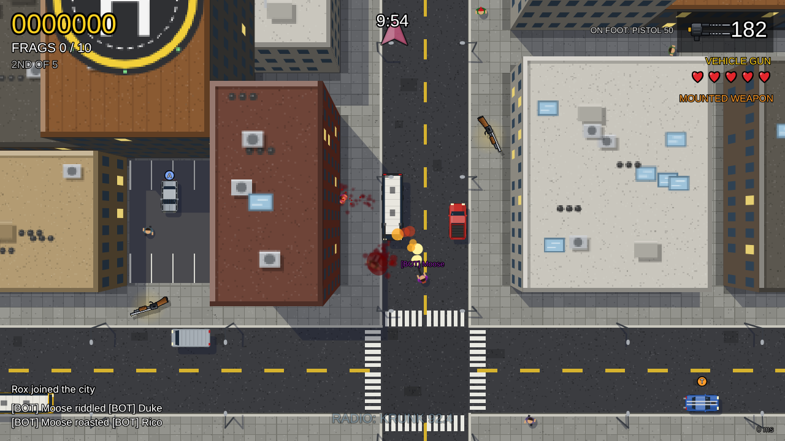

# RoxTown Carnage

A top-down multiplayer crime sandbox for the browser, in the spirit of GTA2's deathmatch: overhead camera with leaning buildings, car-jacking, crates, frags and a lot of explosions. Play it with friends over a small Node.js server, or alone against bots. All art and sound effects are generated in code; the only asset is the file of voice clips.



**Features at a glance:** deathmatch with bots (five skill levels) · car-jacking, even mid-jump · cars with mounted guns, oil, mines and jumps · helicopters · police with a wanted level · a three-lap race mode · car fist fights · secret chop shops · gang members you pick up with the horn · a car radio · angry Irish, Scottish and London voices · day and night. Everything is listed under [What's in it](#whats-in-it).

## Run it

You need Node.js 18 or newer.

```bash
npm install
npm start
```

Open `http://localhost:8080`. Friends on your network join via `http://<your-ip>:8080`. To play over the internet, forward TCP port 8080 on your router or run it on a VPS. It works behind any HTTPS reverse proxy too (the client switches to `wss://` automatically).

### Hosting it for friends over the internet

The server version is much snappier than the artifact room: everyone talks straight to one server over a WebSocket (typically 20–60 ms within a country), instead of every move going through the claude.ai relay to another player's page. Three easy ways:

- **From your own computer, no router setup:** run `npm start`, then in a second terminal `npx cloudflared tunnel --url http://localhost:8080` (or `brew install cloudflared` / the Windows installer first). It prints a public `https://….trycloudflare.com` link to send to friends. Lag is lowest for you and anyone near you.
- **A small cloud server** (Hetzner, DigitalOcean, Fly.io, Render, Railway…): any Node 18+ host with WebSockets. Copy the folder, `npm install`, `npm start` (it listens on `PORT`, default 8080). Pick a region close to the players: for Sweden, Stockholm or Frankfurt.
- **cPanel web hosting with "Setup Node.js App":** upload and extract the folder outside `public_html`, create a Node.js app (Node 18+, startup file `server.js`, application root = that folder, URL = a subdomain or a path like `/roxtown`), press *Run NPM Install*, then *Restart*. The game works at the site root or under a sub-folder. On hosts that run Node apps through CloudLinux Passenger (DirectAdmin, many cPanel hosts), the panel writes an `.htaccess` into the app folder; it's lost if the folder is deleted or replaced, and the game URL then answers 403 Forbidden. `.htaccess.example` shows what it looks like: copy it to `.htaccess` with your own paths (the panel shows them). To update, copy the new files over the old ones (keep `.htaccess`) and click *Restart*. The start screen shows the version number, so you can see the update arrived. If the page stays on CONNECTING…, the host isn't passing WebSockets through: ask them to enable WebSockets for Node.js apps.
- **Same network (LAN party):** `http://<your-ip>:8080`, near-zero lag.

## Play it as a claude.ai artifact (no server)

`node build-artifact.js` builds `dist/crosstown-artifact.html`, a single self-contained page. Published as an artifact with the `room` capability, it runs the whole game in the browser:

- **Online room:** everyone with the artifact open shares one city. The first player's page runs the game (the host). The others send their inputs through room presence and draw the host's snapshots, compressed to fit the 4 KiB presence limit. If the host leaves or hides their tab, another player takes over, keeping scores and the match clock. The city's cars reset when this happens.
- **Solo:** you against bots, entirely in your page. Used automatically when online play isn't available, for example through a public link.

The lobby also picks the map size (small, medium or large) and islands (none, one or two). The host is settled on the start screen, before anyone hits the streets: while nobody is playing, whoever has been on the start screen longest is the host and picks the city, and everyone else sees those choices locked (the status line says who is hosting). Whoever hits the streets first builds the host's city. Once a city is running, the start screen shows its options, locked, and you join it. This works the same in an online room and on the server, and the city stays the same if another player takes over as host.

The server version is still the better choice for larger groups or players far apart, because each artifact player's moves have to go through the host's page. To keep it smooth anyway, your own movement and gunfire react instantly on your screen; every update you send carries your last two seconds of keys (run-length encoded), so a slow relay loses none; while your keys are on their way the host keeps doing what you were doing and then catches up without running ahead of your screen; and each player's page measures how evenly the host's updates arrive and buffers just enough to draw everyone else without stutter. On top of that the host lag-compensates people on foot: each page measures how old the cars on its screen are compared to the moment the host plays its keys, and the host checks that player against where the cars were on their screen (each car remembers its last second). So a jump timed to what you see clears the car, even if your screen is half a second behind the host. Gunfire works the same way: the host checks your bullets against where the other players, people and cars were on your screen (up to 0.7 s back), and everyone else's muzzle flashes, tracers, hits and explosions are played at the moment the world on your screen reaches them, so they come out of the gun as it's drawn.

## Server options (environment variables)

The start screen has the same city options as the artifact: bots off or on (one bot), bot skill, map size and islands. The first player to join an empty server picks them; anyone joining later plays in that city, and the start screen says what's running. The variables below set the city the server starts with.


| Variable | Default | What it does |
|---|---|---|
| `PORT` | `8080` | HTTP/WebSocket port |
| `BOTS` | `1` | How many bots play while at least one person is in (`0` = no bots; change it in the game from the Tab menu) |
| `FRAGS` | `10` | Frag limit per match |
| `MINUTES` | `10` | Time limit per match |
| `SEED` | random | City layout seed (same seed = same city) |
| `MAP_SIZE` | `medium` | `small`, `medium` or `large` city |
| `ISLANDS` | `0` | `1` or `2` parts of the city cut off by rivers, reachable only over bridges |
| `TRAFFIC` | by map size | Number of moving traffic cars around the players (7 / 11 / 16; `0` = none) |
| `POLICE` | on | `0` starts matches with the police switched off |
| `ARSENAL` | off | `1` = everyone spawns with every weapon |
| `LAG` | `0` | Simulated one-way latency in ms, for testing netcode |

Example: `BOTS=6 FRAGS=30 SEED=4242 MAP_SIZE=large ISLANDS=2 npm start`

## Controls

GTA2-style layout:

| Key | Action |
|---|---|
| Arrow keys | Move (classic rotate-and-walk, or direct 8-way, chosen in the lobby) / drive |
| Ctrl | Fire (on a Mac, Option also fires, because Ctrl+arrows switches desktops) |
| Space | Jump on foot (over cars, onto their roofs) / handbrake in a car |
| Enter | Get in or out of a car. Occupied cars get car-jacked, even in the middle of a jump |
| H | Horn. Next to gang members, it picks them up for your crew |
| Z / X | Previous / next weapon. In a car with mounted weapons, one list: the car's weapons first, then your own (Ctrl does nothing while one of your own is picked; it's the gun in your hand when you get out) |
| N | Time of day: day, night, or day + night cycle |
| R | Next radio station (in a car) |
| K | Radio on/off |
| Tab | Menu: players and frags, sound, radio, time of day, police on/off, full screen, restart match, quit, volume sliders (master, effects, voices, radio), and a list of all keys including the fist fight moves (Tab or Esc closes it) |
| T | Chat |
| M | Mute |

On phones and tablets, on-screen buttons appear automatically.

## What's in it

- **Weapons:** pistol (one shot per press of Ctrl: tap it for each shot), dual pistols, machine gun, shotgun, electro gun (chains between targets), flamethrower (sets people and cars alight), rocket launcher, grenades, molotovs
- **Fists:** when you're out of ammo (or pick them with Z/X) you fight with your bare fists: one punch per tap (a slower one every 0.6 s if you hold Ctrl). A pedestrian takes 4 punches, a player 12
- **Car-jacking** throws the driver out next to their car without running them over
- **Vehicle weapons** (grey crates on roads, collect while driving): vehicle machine gun, oil slicks (gone after 30 seconds) and car mines (both drop as fast as you press fire), and **car jump** (5 jumps: the car leaps as high as a jump on foot but floats for almost a second, so at speed it clears other cars, the barriers at the end of a road and the river beyond them, and it lands on low one-storey roofs just like you can on foot: drive around up there, get out onto the roof, or drive off the edge). Land on another car and it's nearly wrecked, but still drives
- **Hidden helicopters:** one to three (by map size) sit on helipads on top of 7-storey buildings, taller than anything else in town, so no amount of roof-jumping gets you there (other roofs have decoy helipads). Somewhere at the foot of each one, usually round the back, is a trampoline: walk onto it facing the building and it throws you up onto the roof (no fall damage if you miss). Get in and it takes off: fly anywhere over the city, Ctrl fires missiles that streak down onto the street ahead. After the 10th missile it goes down in a spin onto the nearest street and you crawl out of the wreck. A minute later a new one is back on its pad. Enter while flying lands it (on a roof or the street) and lets you out A rocket that flies through a helicopter in the air (where you see it on your screen, or right under it) brings it down in flames and kills the pilot.
- **Race mode:** every city has one chequered race flag on a road somewhere. Touch it (on foot or driving) and everyone is in a race: all racers are put on foot on the start line, with a fast car for each parked just behind, held there through 3-2-1-GO, then three laps through 8 to 12 checkpoints around the city, in order, with a chequered start/finish line under a gantry. A big arrow over you points to your next checkpoint, with the distance; the race panel shows your lap, checkpoints and place. The fighting doesn't stop. First home wins 2500 points, the chequered flag and a champagne shower, then it's back to normal and the flag returns 45 seconds later (a race nobody finishes in 7 minutes is called off). Bots race too: on GO they run for a car and drive the course, following the streets from checkpoint to checkpoint; the higher their skill, the harder they push through the corners. A standings table on the left shows every racer in order, with their lap and checkpoints, and the result once someone wins. Bots driving (racing or hunting) look ahead for walls and cars and slow down for them; the lower their skill, the earlier and more carefully.
- **Health boosts:** points for taking out people on the street add up (10 a pedestrian, 20 for a splat, 30 a cop), and every 100 gives you +25 health (never past 100). Frags, car-jackings and fist-fight wins don't count towards it
- **River jumps:** where a road dead-ends at a river there's sometimes a ramp. Hit it at speed and you fly across; too slow and you're swimming
- **Gang members and your crew** (like GTA2, where gang members climb in when you pull up next to them and sound the horn): a few gang members in green jackets and red bandanas hang around on the pavements. Stop next to them in a car and honk (**H**, or the HORN button on touch screens) and they jump in, as many as the car has seats (up to three; two-seaters take one). While they ride with you they lean out of the windows and shoot at anyone after you: other players, bots, other players' crews and cops on your tail. Get out and they get out too, follow you on foot in a spread-out group and fight beside you; get back in and they climb back in. You can't hurt your crew and they can't hurt you; a ring in your colour marks them, and the HUD shows your crew. If you die, your crew dies with you in the car, or splits up and goes back to the street. Shoot a gang member who isn't yours and he shoots back
- **Secret chop shops** (two per city, three in a large one): an unmarked roller door with a graffiti tag in the wall of a low building, oil stains and paint overspray on the pavement in front. Drive in slowly and you come out with a fresh paint job, a random car weapon (vehicle gun, oil slick, car mines or car jump, with 50% more ammo than a crate gives) and no wanted level, because the police lost your description. Each shop serves you once a minute
- **Weapon pickups** float and turn slowly over the pavement, no crate. Weapon and pickup icons are shaded side views (steel, wood, glass, polymer), drawn once at high resolution and reused, so they stay sharp in the HUD and cheap to spin (car weapons still come in grey crates on the roads)
- **Power-ups:** health, armour, double damage, invisibility
- **Vehicles:** coupe, speedster, sedan, cab, pickup, box van, city bus, muscle car. Each has its own speed, grip and toughness. Damaged cars smoke, then burn, then explode (chain reactions included). Cars are fairly tough, and once one catches fire you have about five seconds to get out or clear off. Drive into the harbour and you drown, though the first car-width of water along the shore is a grace band where you can still back out
- Jumping (clear a car if you time it, land on roofs and ride along), fists when you run out of ammo, GTA2-style voice callouts for pickups and WASTED
- Car radio: every car has its own station. The server version streams real internet radio (radio-browser.info, SomaFM as backup); the artifact generates its stations in the page because artifacts can't load outside audio
- A sun that moves across the sky during each match, with building, tree, car and player shadows and warm evening light
- Weapon and power-up crates can be grabbed while driving
- About one car in five comes with upgrades, shown as badges over empty cars: Turbo (T), Armour (A), Sport grip (G) and a mounted weapon (W)
- Pedestrians on the pavements: they scatter and scream at gunfire and splat when you hit them (+10 points, +20 for a splat)
- Police, as in GTA2 (switch them off in the Tab menu): killing pedestrians or hurting cops raises your wanted level (up to 4 stars). At one star the cops try to arrest you (BUSTED), at two or more they shoot. A cop who reaches your car while it's slow pulls you out: you then have two seconds to run before you're BUSTED, or get back into your car and you fight the cop for it, fist fight style (win and you keep the car, lose and you're busted). Invisibility hides you from them: they go to where they last saw you and lose interest At most two cops at a time, each arriving in a police car with lights and siren (which you can steal). Stay out of sight long enough and they lose interest. They're still a bit clumsy (a little slower than you, and they stop for breath now and then), but they react quickly, lead a moving target and hit fairly often
- **Islands and bridges:** with one island a river cuts off the east of the city; with two, a second river also cuts off the south-west. The only way across is over a few bridges with railings (drive or run across). Roads that end at a river have barriers, and the rivers are too wide to jump
- **Car fist fight:** steal the same car back and forth with someone (the third steal between the same two players within 30 seconds) and you both drop everything for a Mortal Kombat style fist fight over it. Best of three rounds with health bars, a round clock, combos and special moves, then FINISH HIM and a finishing move. The winner drives off in the car and gets the frag; the loser is wasted. Nobody can hurt either fighter while it lasts, and everyone else sees a brawl cloud by the car. Bots join in too: now and then one pulls you out of a slow car and sits in it, and a bot you pull out of a car wants it back
- **Traffic:** civilian cars drive around the players, keep to the right-hand lane, turn at junctions, U-turn at dead ends, go round parked cars, and stop and honk if you stand in the road. Pull the driver out and the car is yours; shoot it up and the driver bails out and runs. Getting hit by traffic doesn't cost you a frag
- **Abandoned cars** fade out a minute after their driver left them (wrecks clear after 30 seconds). Cars still parked where the city put them stay, and a fresh one turns up out of sight to keep the streets full
- Running people over, car-jacking, skid marks, blood and scorch marks that fade away after about 30 seconds, district names as you cross town
- Frag-limit and time-limit matches with automatic restart, kill feed, chat and pathfinding bots
- **Bots drive too:** now and then a bot takes a car (an empty one, or it jacks some traffic) and hunts someone down, trying to run them over and using the car's guns, oil and mines when it has them; after half a minute or so, or once the car is wrecked, it gets out. Bots also come back from the dead with a random weapon (machine gun, shotgun, flamethrower, rocket launcher, grenades…) and now and then pick something other than the obvious weapon, so they don't all fight the same way. Higher skill: they go hunting more often. If you drive around near a bot, it's likely to grab a car of its own and chase you, sticking to you while you're in reach
- **Bots:** on the start screen, bots are off or on (one bot) plus a skill slider: ROOKIE, EASY, STREETWISE, HARD, PSYCHO. Skill sets how fast a bot reacts and rethinks, how well it aims, how far it spots you and how hard its hits land (a bot with a pistol kills a standing target in about 10 s at ROOKIE, 3.5 s at STREETWISE and 2 s at PSYCHO; at every level about half a bot's shots go wide). In the game, the Tab menu has a − / + for how many bots (0 to 8) and the same skill slider; anyone can change them and everyone sees who did

## Day, night and animation

Pick DAY, NIGHT or DAY + NIGHT in the lobby (or press N in game). After dark, the city is lit by street lamps (a few flicker), headlight cones and tail lights, lit windows, beacons on tall buildings, muzzle flashes, explosions, fire and electro bolts. Lamps and headlights fade on at sunset instead of switching on.

Animation eases everywhere: cars lean on their suspension and show steering front tyres; doors swing open and shut and people step in and out; walking eases in and out; jumps squash and stretch; bodies fall and blood spreads; crates pop in and out; HUD messages, the score and the weapon icon animate.

The lighting and animation ideas were inspired by [GTA2 RTX Remix (Upgraded)](https://github.com/kirmm3la/gta2-rtx-remix-upgraded) (MIT); RoxTown's code is its own and uses no GTA2 assets.

## Fist fight moves

Directions are relative to the way you face (forward = towards your opponent). On phones, FIRE punches and JUMP kicks.

| Input | Move |
|---|---|
| Ctrl | Punch (a high jab: it goes over a crouching opponent) |
| Space | Kick |
| ↑ / ↓ | Jump (Space in the air for a flying kick) / crouch |
| Hold back | Block (hold back + down to block a sweep) |
| ↓ + Ctrl | Uppercut (knocks down) |
| ↓ + Space | Sweep (knocks down, blocked only crouching) |
| back, forward, Ctrl | Hubcap toss (thrown, duck under it) |
| forward, forward, Space | Flying knee |
| ↓, back, Space | Spin heel |

Hits that land while the other fighter is still reeling count as a combo, and each hit after the second does extra damage. Named combos do extra damage and knock down: **Street combo** (punch, punch, kick), **Carjacker combo** (punch, kick, uppercut) and **Road rage** (kick, kick, spin heel).

The fight reacts instantly for both fighters, online too: each fighter's page runs the fight itself from the game's latest state plus the keys pressed since (`shared/fight.js` is deterministic, so the replay matches the game exactly). The opponent's moves arrive with the network delay and the fight is quickly re-run when they do, rollback-style, like modern fighting games.

Finishing moves, only when FINISH HIM is on screen:

| Input | Fatality |
|---|---|
| back, back, Space | **Car crush** (any distance): the car you were fighting over falls on them |
| ↓, ↑, Ctrl | **Sky high** (up close): an uppercut into orbit |
| forward, back, forward, Ctrl | **Fire starter** (mid range): one molotov |

## Sound and voices

Volume sliders for everything, sound effects, voices and the car radio are in the Tab menu; the radio starts at 30%.

All sound effects are synthesised in the browser. Gunshots are rendered sample by sample when the page starts (four variants per gun, pitch-varied on playback): a supersonic crack, a muzzle blast through a closing filter, a low boom, soft clipping, slap-back echoes off the street walls and a rolling city echo, plus each gun's mechanics (pistol slide, machine-gun bolt, the heavier car gun, the shotgun's pump) and now and then a spent casing tinkling on the tarmac. The rest is synthesised live: explosions and crashes, a city-street reverb, stereo panning and distance muffling, an engine that shifts through gears, continuous tyre screech and footsteps. Every voice is an angry Irish or Scottish one, plus a pirate: eleven people on the street (Irish men from Dublin, Tipperary and Donegal and a furious Dublin woman; a posh London woman; Scots from Glasgow, Edinburgh, Fife, Aberdeen and West Lothian; and a gravelly old pirate), a Scottish cop and a Scottish fight and race announcer. They are short clips in `public/voices.js`, generated by `tools/make_voices.py`. Each voice starts from a few seconds of a real Irish or Scottish speaker made with [Piper TTS](https://github.com/rhasspy/piper) (MIT) from the VCTK voice (speakers of the CSTR VCTK Corpus) or the Scottish Alba voice (both University of Edinburgh, CC BY 4.0). [Chatterbox TTS](https://github.com/resemble-ai/chatterbox) (Resemble AI, MIT) then speaks every line in that voice with its emotion exaggeration turned up, so the anger is in the delivery. Chatterbox adds an inaudible watermark marking the audio as AI generated. Regenerating all voices takes about an hour on a CPU. Three of them are different: the posh London woman, the furious Glaswegian and the Dublin woman have no real speaker behind them. Their voices were designed from a written description ("a very posh English woman from Kensington… shrieking with indignant fury") with [Qwen3-TTS](https://github.com/QwenLM/Qwen3-TTS) VoiceDesign (Apache 2.0), by `tools/make_designed_voice.py`, which needs its own Python environment (`pip install qwen-tts`). `make_voices.py` keeps their clips as they are.

## How it works

- `shared/game.js` is the whole simulation, used by the server, the solo page and the room host. `shared/fight.js` is the fist fight, which `game.js` runs.
- `server.js` runs it at 60 Hz, authoritative over physics, damage, pickups and bots, and sends snapshots at 30 Hz, only including cars and projectiles near each player.
- `shared/shared.js` is loaded by both sides. It holds the seeded city generator, tables, and the ped and car physics.
- `public/client.js` predicts your own movement with the same physics code and reconciles with the server, so steering feels instant even with latency. Other players are interpolated.

## If players get disconnected

The game reconnects by itself (up to six tries over about 20 seconds) before it shows the RECONNECT button; you come back into the same city as a new arrival. The server pings every player every 15 seconds, which keeps proxies from closing quiet connections, and drops players whose connection died without closing.

To find out why a drop happened, look at `errors.log` next to `server.js` on the host: every server start is written there (`server started (pid …)`), and so is any error in the game. A new `server started` line at the time of a drop means the host restarted the app (CloudLinux/Passenger restarts or memory limits); an error line means a bug, and the game now keeps running past it. No new line means the connection itself dropped (Wi-Fi, mobile data, the browser putting a background tab to sleep). `GET city` also reports `up`, the seconds since the server started.

## Project layout

| Path | What it is |
|---|---|
| `server.js` | The Node server: serves the page, runs the game, talks to players over WebSockets |
| `shared/shared.js` | The city generator, physics and constants, used by the server and the browser |
| `shared/game.js` | The game itself: players, bots, cars, weapons, police, races, crews (runs on the server, or in the host's browser in the artifact) |
| `shared/fight.js` | The car fist fight (the side-on brawl after a car-jacking) |
| `public/client.js` | The browser side: drawing, sound, prediction, HUD, controls |
| `public/room.js` | The claude.ai artifact version: lobby, host election and the compressed room transport |
| `public/index.html` | The page and start screen |
| `public/voices.js` | The voice clips (generated; see below) |
| `tools/` | The scripts that generate the voices |
| `build-artifact.js` | Builds the single-file artifact into `dist/` |

## Credits and licenses

The code is MIT licensed (see `LICENSE`).

The voice clips in `public/voices.js` were generated with text-to-speech and are not covered by the MIT license:

- Most voices: [Chatterbox TTS](https://github.com/resemble-ai/chatterbox) (Resemble AI, MIT), in voices made with [Piper TTS](https://github.com/rhasspy/piper) (MIT) from the VCTK voice, trained on the [CSTR VCTK Corpus](https://datashare.ed.ac.uk/handle/10283/3443), and the Scottish Alba voice, both University of Edinburgh, [CC BY 4.0](https://creativecommons.org/licenses/by/4.0/). Chatterbox marks its audio with an inaudible watermark identifying it as AI-generated.
- The posh London woman, the Glaswegian and the Dublin woman: [Qwen3-TTS](https://github.com/QwenLM/Qwen3-TTS) VoiceDesign (Apache 2.0).

Keep this attribution if you reuse the clips. The server version's car radio streams stations listed by [radio-browser.info](https://www.radio-browser.info/) (SomaFM as a fallback); those streams belong to their stations.

RoxTown Carnage is a fan-made game inspired by Grand Theft Auto 2. It is not affiliated with or endorsed by Rockstar Games or Take-Two Interactive, and it contains none of their code, art or sound.

